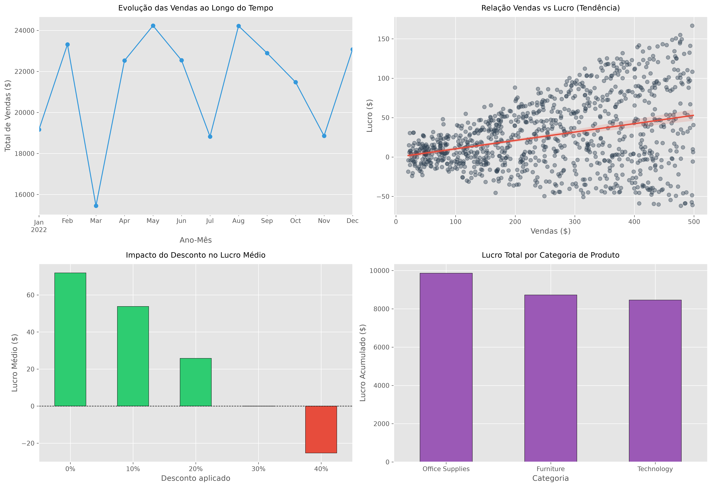

# Análise de Vendas e Lucratividade

👉 **[Ver o notebook com a análise completa](notebook/analise.ipynb)**

## Objetivo
Analisar dados de vendas para identificar os principais fatores que impactam a lucratividade, com foco no efeito dos descontos, na comparação entre categorias e na evolução mensal das vendas.

---

## Resultado principal
Neste dataset, o desconto é o fator que mais explica o lucro: a correlação entre lucro e desconto é de **-0,79**. O lucro médio por pedido cai de **$71,94** (sem desconto) para **praticamente zero** com 30% e para **-$25,29** com 40%.

---

## Dados
Dataset **simulado** (1.000 pedidos, jan a dez/2022), inspirado no Superstore, sem valores nulos nem duplicados.

**Limitações:** não representa uma empresa real, cobre um único ano e as relações entre as variáveis vêm da forma como os dados foram gerados. O foco do projeto é o método analítico. Detalhes em [`data/data_documentation.md`](data/data_documentation.md).

---

## Ferramentas e Bibliotecas
- **Linguagem:** Python 3.x
- **Manipulação de Dados:** Pandas
- **Visualização:** Matplotlib & Seaborn
- **Ambiente de Desenvolvimento:** GitHub Codespaces / Jupyter Notebook

---

## Escopo da Análise
- **Análise Temporal:** Evolução mensal das vendas em 2022.
- **Análise de Correlação:** Dispersão e linha de tendência entre Vendas e Lucro, e matriz de correlação entre as variáveis numéricas.
- **Impacto do desconto:** Efeito de cada nível de desconto no lucro médio por pedido.
- **Segmentação por Categoria:** Comparação do lucro e da margem entre as três categorias.

---

## Principais Insights
- **Desconto e lucro:** correlação de -0,79. O lucro médio por pedido cai de $71,94 (sem desconto) para praticamente zero com 30% e para -$25,29 com 40%.
- **Vendas e lucro:** relação positiva e fraca (+0,33). Vender mais não garante lucro proporcional.
- **Categorias:** margens parecidas (10,0% a 11,6%). Nesta base, o desconto explica o lucro mais do que a categoria.

---

## Painel Visual

O painel reúne os quatro gráficos da análise. No gráfico de desconto, a barra vermelha marca o nível com prejuízo médio (40%); com 30% o lucro médio é praticamente zero.



*Figura 1: Evolução mensal das vendas, relação entre vendas e lucro, lucro médio por nível de desconto e lucro total por categoria.*

---

## Conclusão e Recomendações

Neste dataset simulado, o desconto é o fator que mais explica o lucro: a correlação entre lucro e desconto é de -0,79, enquanto vendas e lucro têm relação positiva e fraca (+0,33). Dos 297 pedidos com prejuízo, 274 tiveram desconto de 30% ou mais.

**Recomendações (caso o padrão se confirme em dados reais):**
1. Limitar descontos a, no máximo, 20%, pois a partir de 30% o lucro médio zera.
2. Monitorar pedidos com desconto igual ou acima de 30%.
3. Acompanhar metas de lucro e margem, e não só de vendas.

---

## Como Executar o Projeto

1. Instale as dependências do arquivo `requirements.txt`:
   ```bash
   pip install -r requirements.txt
   ```

2. Abra o notebook:
   ```text
   notebook/analise.ipynb
   ```

3. Execute as células de cima para baixo. O painel é salvo em `dashboard/painel_lucratividade.png`.

---

## Estrutura do repositório
```text
├── data/          dataset simulado e documentação
├── notebook/      analise.ipynb
├── dashboard/     painel_lucratividade.png
└── requirements.txt
```
